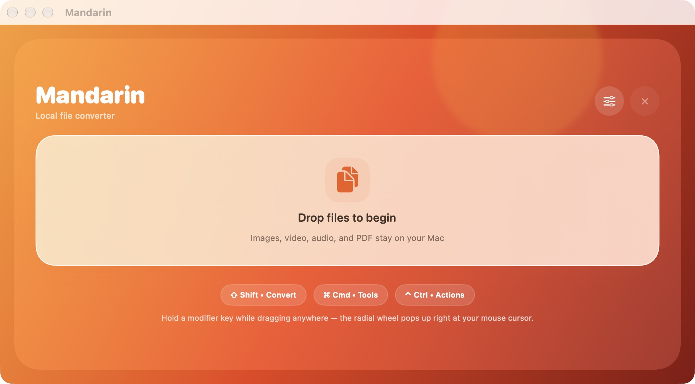

# Mandarin

드래그 앤 드롭과 원형(Radial) 메뉴로 이미지·동영상·오디오·PDF를 변환하고 편집하는 macOS 유틸리티 앱입니다.



## 기능

- 이미지, 동영상, 오디오, PDF 포맷 변환 및 동영상에서 오디오 추출
- 이미지 자르기·메타데이터 확인, PDF 병합 및 페이지 편집
- 파일 드래그 중 단축키(`Shift` 변환 / `Cmd` 도구 / `Ctrl` 동작)로 커서 위치에 원형 메뉴 호출
- 출력 폴더 지정 및 이미지 변환 품질 설정

## 실행 방법

```sh
git clone https://github.com/INT31302/Mandarin.git
cd Mandarin
open Mandarin.xcodeproj
```

Xcode에서 **Mandarin** 스킴과 **My Mac**을 선택해 실행합니다. 창에 파일을 드롭하거나 드래그 중 보조키(`Shift`, `Cmd`, `Ctrl`)를 눌러 원하는 작업을 선택할 수 있습니다.

## 구조

- `Mandarin/` — 메인 UI, 원형 메뉴 세션(`WheelSession`), 포맷 변환 엔진, 파일 편집 도구
- `Validation/`, `tests/` — 파일 도구 및 원형 메뉴 지오메트리 테스트
